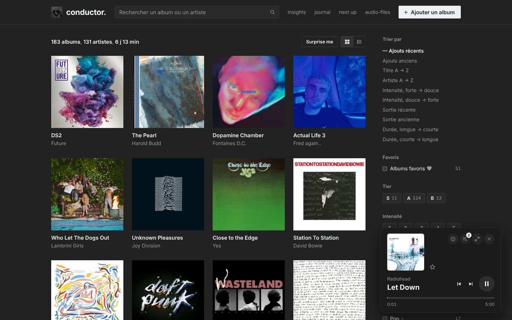
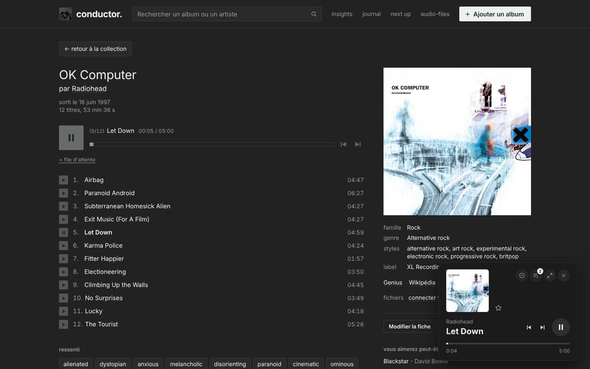
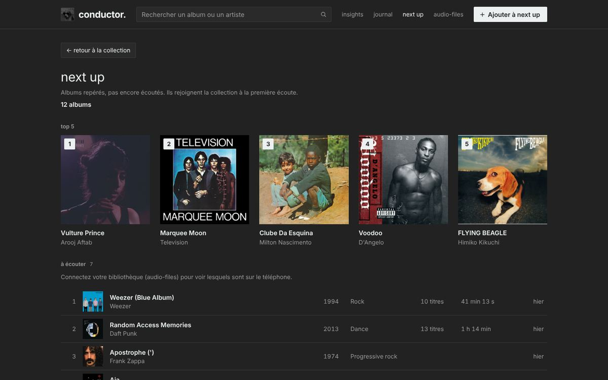
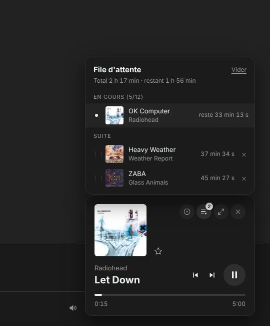
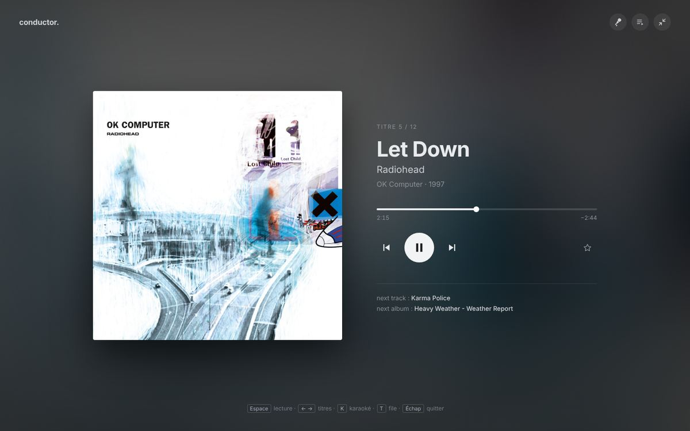
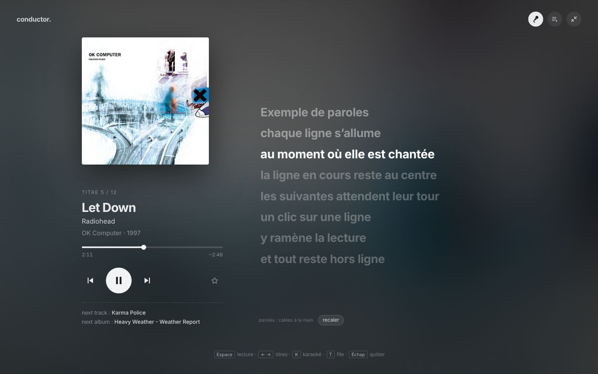
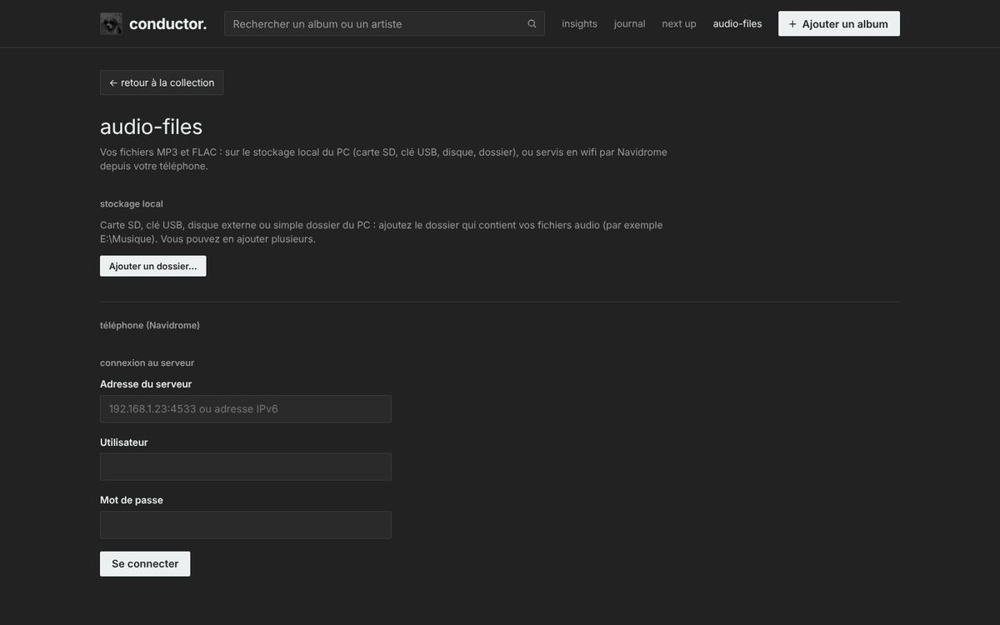
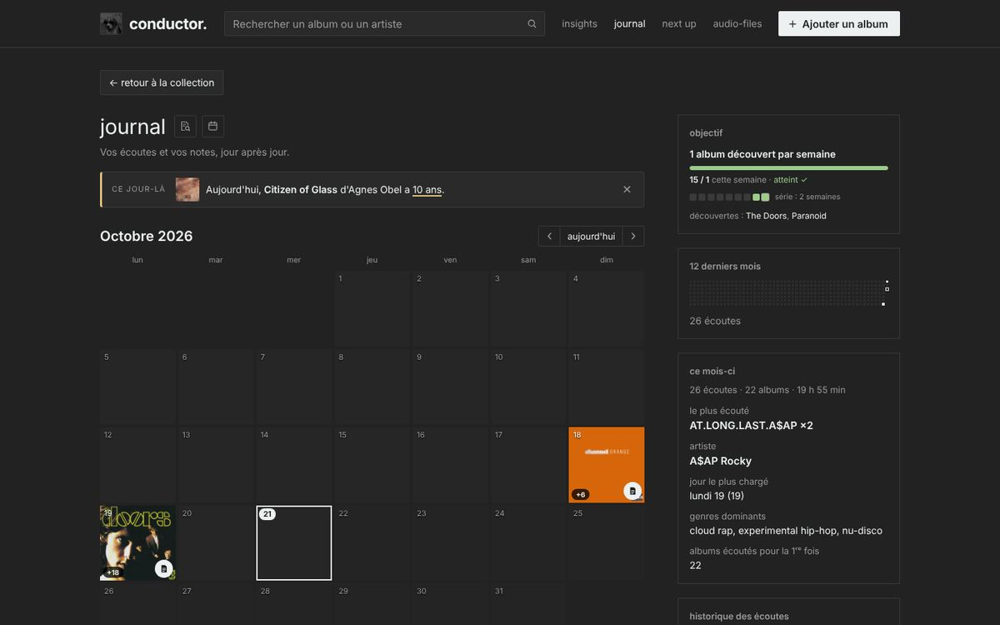
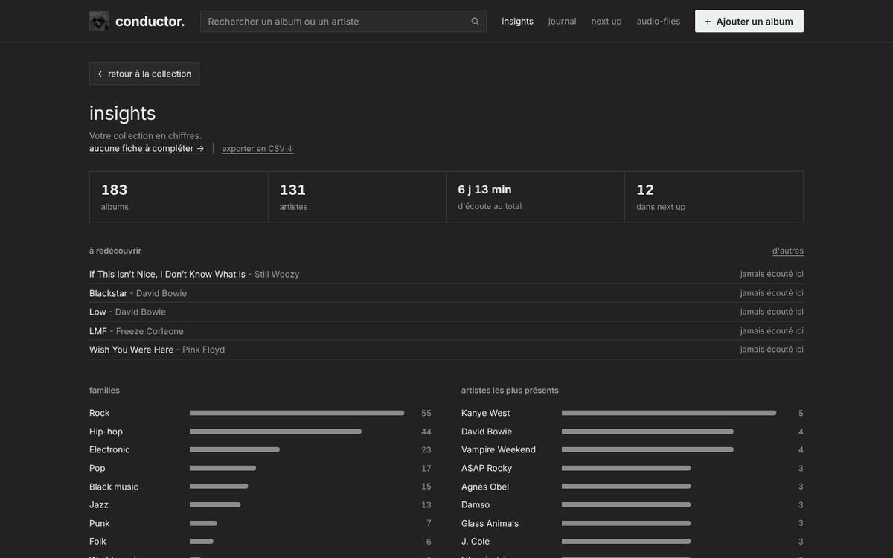
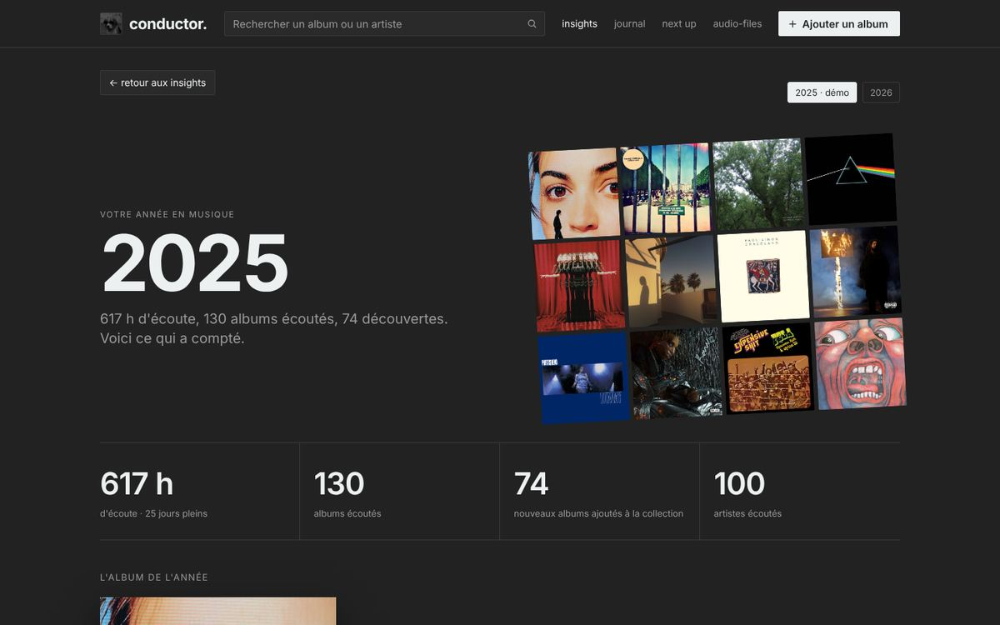

# conductor.

A personal, local-first music library, listening journal and audio player. Inspired by Bandcamp,  Musicboard and Obsidian.

- **Plain HTML, CSS and JavaScript** — no server, no build, no install. Open `index.html` in Chrome or Edge.
- **Single page** — everything runs inside `conductor.html`, which never reloads: the music keeps playing while you browse.
- **Your data on your PC** — collection, notes, lyrics, covers and backups live in `datastorage/`, next to the code. Works offline.
- **Your own files** — play MP3/FLAC from an SD card, a USB stick or any PC folder, or stream them from your Android phone (Navidrome) over Wi-Fi or a USB cable.

The interface is in French.



---

## Contents

- [conductor.](#conductor)
  - [Contents](#contents)
  - [Features](#features)
    - [Collection](#collection)
    - [Album page](#album-page)
    - [Bacs](#bacs)
    - [Artist page](#artist-page)
    - [Next up](#next-up)
    - [Playback](#playback)
    - [Full screen and karaoke](#full-screen-and-karaoke)
    - [Lyrics](#lyrics)
    - [Your audio files](#your-audio-files)
    - [Journal](#journal)
    - [Insights and fiches à compléter](#insights-and-fiches-à-compléter)
    - [Wrapped](#wrapped)
    - [Data, backups and exports](#data-backups-and-exports)
  - [Keyboard shortcuts](#keyboard-shortcuts)
  - [Working offline](#working-offline)
  - [Structure](#structure)
  - [Getting started](#getting-started)
  - [Documentation](#documentation)
  - [Browser support and limits](#browser-support-and-limits)

---

## Features

### Collection

- **Grid or list view**, 20 albums per page, remembered between visits.
- **Sort** by date added, title, artist, intensity, release date, length, or number of listens (most / least played).
- **Filters**: genre families (folded by default, unfold to pick genres), decades, intensity, tier (S / A / B), favourite albums, on the phone, A–Z letter. `Z` resets the filters, `H` resets everything.
- **Search** across title, artist, genre, family, styles, moods, tags and label, accents ignored:
  - `jazz+fusion` — both words present (in any field);
  - `radiohead/glass animals` — either one;
  - combinable: `jazz+fusion/ambient`.
- **Play buttons on covers** (on hover): ▶ plays the album now (the queue is kept; pause/resume on the album playing), "3 lines +" adds it to the queue (green check for 2 s). With nothing playing, a single ▶ starts the album.
- **Surprise me** (`R`): a random album.
- **Colours**: browse the collection by the dominant colour of the covers (red, orange, yellow, green, turquoise, blue, purple, pink, brown, black, grey, white) — a foldable **Couleurs** section of the filters, one colour at a time (click again to remove it). The colour is computed once per cover, from the local copy in `datastorage/covers/` (so the folder must be authorised), and again when the cover changes.
- **.txt export** of a search or filter result.
- **No duplicates**: an album already in the collection (or in next up) is recognised when you add it again — same id, or a close name ("Remastered 2009", "[Deluxe]", "The Beatles" / "Beatles", "feat. …", "&" / "and") — and is not added twice; the add window offers to open its page instead.

### Album page

<p align="center"></p>

- **Player**: your own files (local folders or Navidrome) or, without files, 30-second Deezer previews.
- **Tracklist** with ★ favourite tracks and per-track **lyrics** (see [Lyrics](#lyrics)).
- **Sheet**: release date, label, genre, styles, family, moods ("ressenti"), custom tags; edit with **Modifier la fiche** (`E`), including the cover (URL, image from the PC, or the cover of your files). In that window, an image copied elsewhere can be pasted as the cover: **right-click the cover preview → Coller la pochette depuis le presse-papiers**, or `Ctrl + V` (Chrome may ask once for clipboard access for the right-click).
- **Intensity** 1–10 and **tier S / A / B** (Masterpiece / Excellent work / Very good job — see `docs/tier-guide.md`).
- **Listens**: count and date of the last one.
- **Thoughts**: a "thoughts" link next to the album title (on hover, like "paroles"; or `W`) opens a window of dated notes on the album — thoughts, impressions — as many as you like, newest first; `Ctrl + Enter` to add. If the album is playing, the note records the track and second (♪ 2. Paranoid Android · 02:15). Edit or delete each note; an unsent draft is kept. Saved in `collection.js`. They also appear in the **journal** under the note of the day they were written, and `Alt + S` searches them with the notes.
- **You may also like**: 4 similar albums from your collection, refresh for others.
- **Files**: shows where the audio comes from (local folder or phone), with **relier à vos fichiers** to link the album by hand (search in your local folders and on the phone), **changer** and **délier**.

### Bacs

**bacs** page (next to insights in the menu, `Alt + B`): album selections, like playlists but for albums.
- All bacs as cards (2 × 2 cover mosaic, or a chosen cover; number of albums, total length), sorted A → Z or by last change.
- One bac: **▶ Lire le bac** (plays the first album, the others go to the queue), **Ajouter à la file**, rename, delete; add albums from the collection (search by title or artist), reorder by drag and drop (like next up), remove ×; on each album, ▶ plays it and ≡+ adds it to the queue.
- **Cover of a bac**: automatic mosaic, the cover of one of its albums, an image from the PC, or an image pasted with `Ctrl + V`.
- From an album page: **Bacs** button (`B`) — tick the bacs it belongs to, or create a new one with the album in it.
- Saved in `datastorage/collection.js` (so in backups and the archive).

### Artist page

All their albums by release date (with the same ▶ / queue buttons on covers), total length, average intensity, genres, years, favourite tracks, copy of the album list. Artist names link to it everywhere.

### Next up

<p align="center"></p>

- A to-listen list kept apart from the collection.
- **Top 5** priority grid, then "on the phone" / "not on the phone" lists; drag and drop to reorder; one click moves an album to the collection.
- **Sleeping albums**: in next up for more than 3 months and never played — listed at the top, marked "endormi" on covers and in yellow in the lists.

### Playback

<p align="center"></p>

- **One engine for the whole site**: the music continues across pages and resumes after a reload, at the same track and second.
- **Mini player** (bottom right): cover, track, ★, previous / next, play / pause, progress, go to the album, queue, full screen, close.
- **Queue** of albums: add the same album several times, reorder by drag and drop, remove, total and remaining time ("En cours (6/11)").
- **Gapless playback**: the next track is preloaded 30 s before the end and starts exactly when the current one ends.
- **Listen counting**: an album counts as listened when **90 % of its length** was actually played (pauses and skips don't count) **and 90 % of its tracks** were heard (each at least halfway). The **last album of a session** (when the app is closed) counts from 60 % / 60 %, to leave a trace in the history. An album's progress lasts for the session: kept if the page is reloaded, reset when the app is closed. Listening time per day feeds the journal.
- **Volume** 0–20, remembered.
- **Media keys and Windows media panel**: the keyboard's play/pause, next and previous keys work even when the browser is in the background, and Windows' volume / media panel shows the track, artist, album and cover (the local cover once `datastorage` is authorised, otherwise the online one).

### Full screen and karaoke

<p align="center"> </p>

- **Full screen** (`P` or the ⤢ button): large cover on a blurred background, track, artist, album, progress, controls, ★, *next track* and *next album*. The cursor and hints hide after 3 s without moving the mouse. `Esc` or `P` to leave.
- **Karaoke** (`K` or the microphone button): synced lyrics next to the cover — the current line is highlighted and stays centered, click a line to jump there, scroll freely (auto-scroll resumes after 4 s).
- **Manual sync** ("caler"): when only plain lyrics exist, or none (paste them), sync them by pressing `Enter` at the start of each line while listening; `Backspace` undoes the last line, `Space` pauses, `Esc` cancels. The result is saved and used forever — see `docs/calage-paroles.md`.
- **Import a `.lrc`** ("importer .lrc", or paste its content in "coller"): timestamps are used as-is, no manual sync; replaces any previous version. A "Lyricsify ↗" button opens a web search for the current track on lyricsify.com.
- **Edit synced lyrics** ("modifier"): fix the text of any line without losing its timing, nudge a line ±0.1 s or set it to the current position, insert / delete lines, or shift the whole song. Saved like a manual sync.

### Lyrics

Both the album page (plain text) and karaoke (synced) look in your files first, then on the internet, and **keep what they find** in `datastorage/` for offline use.

| Order | Album page (plain) | Karaoke (synced) |
|---|---|---|
| 1 | Your saved lyrics (`lyrics/`, incl. edited by you) | Saved synced lyrics (`lyrics-synced/`, incl. synced by hand) |
| 2 | Your files: `.lrc` next to the track, embedded tags (FLAC `LYRICS`, MP3 `USLT`), Navidrome | Your files: `.lrc`, embedded timestamped lyrics, Navidrome synced lyrics |
| 3 | Lyrics kept by the karaoke (timestamps removed) | LRCLIB synced lyrics |
| 4 | LRCLIB | Plain lyrics, ready to sync by hand |

- **Tolerant LRCLIB search**: exact match, then the title without "(feat. …)", "- Remastered 2011", "(Live …)", "Radio Edit"…, with the full artist then the main artist only, keeping only versions of a similar length.
- Plain lyrics found by the karaoke are also kept for the album page; lyrics pasted for a manual sync too.

### Your audio files

<p align="center"></p>

**audio-files** page.

**Local storage** — SD card, USB stick, external drive or any PC folder; add as many folders as you like.
- Pick each folder once with the Chrome/Edge folder picker (browsers don't allow a typed path); one "Autoriser" click per session afterwards.
- Each folder is scanned: title, artist, album, year, track and disc numbers and duration from FLAC/MP3 tags, otherwise from folder and file names (`Artist - Album (1997)/01 - Title.flac`). One folder = one album; `CD1`, `Disc 2`… subfolders are merged. Unchanged files are not re-read.
- Albums are matched to your collection by title and artist (ignoring "Deluxe", "Remastered"…), or linked by hand.
- Albums found in your folders but not in the collection are listed with their cover, ready to add (collection or next up).
- **Covers from your files**: `cover.jpg` / `folder.jpg` / `front.jpg`… or the image embedded in the files, copied to `datastorage/covers/`, for albums without a local cover.
- Local files play first, before the phone and Deezer.

**Phone (Navidrome)** — an Android phone running Navidrome in Termux serves your MP3/FLAC without copying them.
- **Several addresses for the same phone** — home Wi-Fi, phone hotspot, **USB cable (USB tethering, or ADB port forwarding when tethering is unavailable, e.g. no SIM card)**: add them once, conductor. uses the one that answers, at start-up and when the music stops because the network changed (the track resumes where it was). Fully offline over a USB cable.
- Albums split by Navidrome (one track with different tags) are merged back; album covers, embedded lyrics and exact durations come from the phone.
- Albums on the phone but not in the collection are listed, ready to add.

**Remote control from a phone** — iPhone or Android, on Wi-Fi or 4G, no app to install. A small relay runs on the PC (`tools/remote/start-remote.bat`, Node.js, no dependencies); the phone opens its page and controls conductor.: cover, track, play / pause, previous / next, ★, PC volume, gestures on the cover (swipe ← → for tracks, ↑ ↓ for the app volume out of 20), synced both ways; **lyrics** on the phone (microphone button): the karaoke's synced lyrics follow the music, tap a line to jump there; the **queue** (play an album now, remove, reorder by dragging, clear); **thoughts** on the current album (write, read, edit, delete — saved with the album, shown in the journal); a minimal **catalog** — one search bar over title, artist, genre, style, mood, label, year — to play an album or add it to the queue. `Alt + R` opens the remote window (QR code). Started from conductor. (phone icon in the footer → *Démarrer la télécommande*, after running `tools/remote/install-button.bat` once; optional start with Windows) and paired once by scanning a **QR code** with the phone camera (or a 4-digit code); add it to the home screen to use it like an app. On 4G or another network, **Tailscale** links the phone to the PC. See `docs/telecommande.md`.

**From YouTube to conductor.** — a typical path for a new album:

```
YouTube → yt-dlp (tools/telecharger_albums.ps1) → TagScanner → WinSCP → Navidrome (navidrome.sh) → USB cable → conductor.
```

- `tools/telecharger_albums.ps1` (Linux: `telecharger_albums.sh`) downloads each album playlist into its own `Artist - Album (Year)` folder (MP3, cover and tags embedded, resumable). Needs `yt-dlp` and `ffmpeg` (`winget install yt-dlp.yt-dlp`, `winget install Gyan.FFmpeg`).
- **[TagScanner](https://www.xdlab.ru/en/)** (free) is very useful to fix the tags of a whole album at once — artist, album artist, album, year, track numbers, cover — so that Navidrome groups the tracks correctly. On Linux: **Kid3** (or TagScanner under Wine).
- Step by step: `docs/youtube-a-conductor.md`, or the built-in guide « De YouTube à conductor. ».

### Journal

<p align="center"></p>

- **Calendar** of the month with the covers of each day's listens (today highlighted); per day: copy the list (`1. [[Artist]] - [[Album]]`) and open the day's note.
- **Listening time chart** for the displayed month (with its own ‹ aujourd'hui › navigation), month total and today.
- **This month**: most played album and artist, busiest day, top 3 genres (links to the search).
- **Weekly goal**: discover 1 album a week (an album played with the player for the first time; weeks run Monday–Sunday). The journal's side column shows the progress, the days left, the last 8 weeks (green = reached), the current streak and the last two discoveries. Each time the app opens, while the goal isn't reached, a reminder with a red edge appears at the top of the collection (× to hide it).
- **Ce jour-là**: at the top of the journal, one banner per album celebrating its release anniversary, stacked like notifications — "Aujourd'hui, *OK Computer* de Radiohead a 29 ans." — or, if none today, the next ones this week ("Demain, …"). Round anniversaries (10, 20, 25, 30… years) come first and are underlined. Only full release dates count. × hides a banner until the next day.
- **A year ago**, **the last 12 months** heat map, **listening history** (10 per page, "aujourd'hui" / "hier").
- **Daily notes** in Markdown, Obsidian style: headings, bold / italic / underline / highlight, nested lists, tasks, `[[wiki links]]` to albums and artists (with play / queue buttons), `#tags`. Editor shortcuts (`Alt+1…6`, `Ctrl+B/I/U`, `Tab`, `Ctrl+E` preview, `I` to write), autosave, copy, search in notes, **today's note** button (`J`).
- Notes are also written as **Markdown files**, one per day, in `datastorage/journal-entries/` — editable in Obsidian; a file changed by hand is picked up at the next start.

### Insights and fiches à compléter

<p align="center"></p>

- **Insights**: the collection in numbers (albums, artists, total listening time, next up), families, most present artists, decades, intensity, albums to rediscover — every bar links to the filtered collection.
- **N fiches à compléter →**: albums missing a cover, genre, release date, tracklist, intensity or mood, or whose **cover is online only** (its site refused the copy, so it would be blank offline). Filter by criterion, dismiss a criterion per album (×).
- **exporter en CSV ↓**: download the whole collection as a spreadsheet.
- **wrapped**: the year in music (see below).

### Wrapped

<p align="center"></p>

The year in music, computed from your listens (offline). `Shift + W`, or **wrapped** in insights.

- **Release**: each year's wrapped comes out on a surprise day between 20 November and 15 December (fixed per year). A banner on the collection announces it; before that, the page shows "any day now". Past years stay available, one tab per year.
- **Contents**: listening hours and full days (with the difference from the previous year), albums and artists listened to, new albums added; the album of the year and the top 10; top artists (hours), families and genres (clickable: filter or search the collection, with "retour au wrapped").
- **Month by month**: hover a bar for hours and albums, click it for the month's wrap (top 5, families, top genres, average intensity); top 3 of each season below.
- **Records**: busiest day, longest streak, favourite time of day, most played decade, fastest adopted album, most loyal album (most consecutive months); the least played albums of the collection; the year in one sentence (moods, intensity, genres by season).
- **Demo**: when the previous year has no listens, a "démo" tab shows a full wrapped built from invented listens of your collection (nothing is saved).
- An album counts as listened when the player counted a listen (see [Playback](#playback)); "albums écoutés" counts different albums, not launches.

### Data, backups and exports

Everything is written to `datastorage/` (once the folder is authorised), a fraction of a second after each change:

- `collection.js` — albums, journal notes, listening time (read back at start-up, even offline);
- `collection.prev.js` and **daily backups** in `backups/` (last 7 kept);
- `collection.csv` — spreadsheet copy, `;` separator, opens in Excel;
- `covers/` — local copies of every cover;
- `lyrics/` and `lyrics-synced/` — plain and synced lyrics;
- `journal-entries/` — one Markdown note per day.

**One-click archive** — the archive icon in the footer (or `Shift + A`) puts the whole `datastorage` folder, the app code (without `.git` or downloaded audio) and the browser-side settings (phone addresses, preferences) into a single dated `.zip` (`conductor-archive-2026-10-22.zip`), saved wherever you choose: USB stick, external drive, synced folder. No compression (covers already are), a few seconds. A reminder appears on the collection when the last archive is two weeks old. The `app` folder is picked once at the first archive (then one "Autoriser" click per session). To restore: unzip — `app` and `datastorage` side by side make a complete `conductor/` (see `LISEZ-MOI.txt` inside).

---

## Keyboard shortcuts

`?` shows them in the app. They work anywhere unless noted, and never while typing in a field.

| Key | Action |
|---|---|
| `N` | Add an album |
| `S` | Search |
| `R` | Surprise me (collection) |
| `Esc` | Leave a field · back to the collection |
| `Z` | Reset filters (collection) |
| `H` | Home, everything reset |
| `F` | Favourite albums filter (collection) |
| `E` | Edit the album sheet (album page) |
| `W` | Thoughts: your notes on the album (album page) |
| `J` | Today's note (journal page) |
| `Shift + ← →` | Previous / next page (collection, journal history) |
| `Space` | Play / pause |
| `← →` | Previous / next track |
| `↑ ↓` | Volume up / down (out of 20) |
| `M` · `0` · `1` | Mute · volume to zero · volume to max |
| `T` | Queue panel (mini player open) |
| `Q` | Close the mini player |
| `Shift + Delete` | Empty the queue (the album playing goes on) |
| `P` | Full screen |
| `K` | Karaoke (full screen) |
| `O` | Open the page of the album playing |
| `Shift + W` | Wrapped: the year in music |
| `Shift + A` | Archive all your data (.zip) |
| `Alt + I` · `Alt + J` · `Alt + U` · `Alt + A` | Insights · Journal · Next up · audio-files |
| `Alt + G` | Collection |
| `Alt + C` · `Alt + M` · `Alt + H` | Fiches à compléter · Manuals · Listening history (journal) |
| `Alt + R` | Remote control window (QR code for the phone) |
| `Alt + B` | Bacs (album selections) |
| `B` | Put the album in a bac (album page) |
| `Alt + T` | Today's journal note (opened or created), from any page |
| `Alt + S` | Search the journal notes (journal page) |
| `L` | ★ the track playing (favourite track) |
| `Shift + F` | ♥ favourite album (album page) |
| `+` | Add the album to the queue (album page); starts playback if nothing plays |
| `C` | Copy `[[Artist]] - [[Album]]` of the album playing, ready to paste in a journal note |
| `V` | Grid / list (collection) |
| `?` | Help |

Manual lyric sync: `Enter` line starts · `Backspace` undo · `Space` pause · `Esc` cancel.
Journal note editor: `I` write · `Ctrl+E` preview · `Ctrl+Enter` save.

---

## Working offline

Once albums are in the collection and your files are on a local drive (or the phone is on a USB cable), everything works without internet:

- collection, album and artist pages, covers (local copies), filters and search;
- playback of local files and Navidrome over Wi-Fi / hotspot / USB (local network only);
- full screen, karaoke and lyrics already loaded or synced;
- journal, notes, insights, wrapped, next up, exports and backups;
- the phone remote control, when the phone is on the same Wi-Fi as the PC (from 4G or another network, Tailscale needs internet).

Needs internet: adding an album through the search (Deezer, Discogs) and completing sheets (genres, styles, tracklists), Deezer previews, lyrics never loaded before, covers whose site refused the copy (see *fiches à compléter*), Genius / Wikipedia links. Adding an album from your local folders works offline.

---

## Structure

```
conductor/
├── app/                    this repo (code)
│   ├── conductor.html      single-page shell: player, mini player, queue, full screen, disk writes
│   ├── index.html          collection
│   ├── pages/              album, artist, journal, nextup, insights, wrapped, complete, library (audio-files),
│   │                       manuals / manual (step-by-step guides), about
│   ├── css/style.css
│   ├── js/                 one file per page, plus shared modules:
│   │                       data (store), disk (datastorage), playback (engine), sdcard (local folders),
│   │                       navidrome (phone), lyrics / karaoke, cover-actions, shortcuts, volume…
│   ├── assets/
│   ├── tools/              conductor-usb.bat / .ps1 (phone over USB cable: finds its address, opens conductor.),
│   │                       telecharger_albums.ps1 (downloads album playlists with yt-dlp, one folder per album),
│   │                       Linux: conductor-usb.sh, telecharger_albums.sh, install-linux.sh (app menu entries),
│   │                       remote/ (phone remote control: relay.js, start-remote.bat / .sh, public/ page)
│   └── docs/               navidrome-man.md, telecommande.md, daily-tel-usb.md, linux.md, youtube-a-conductor.md, calage-paroles.md, tier-guide.md, toolkit.md
└── datastorage/            your data, outside the repo
    ├── collection.js       collection, notes, listening time
    ├── collection.prev.js  previous version (safety net)
    ├── collection.csv      spreadsheet copy
    ├── backups/            one copy per day (7 kept)
    ├── covers/             local covers
    ├── lyrics/             plain lyrics, per album
    ├── lyrics-synced/      synced lyrics (.lrc), per album and track
    └── journal-entries/    journal notes, one .md per day
```

Keep both folders side by side: the app reads and writes `../datastorage/`.

---

## Getting started

1. Open `app/index.html` in **Chrome or Edge** (it opens the single-page shell). On Linux, run `bash app/tools/install-linux.sh` once: it adds **conductor.** and **conductor USB** to the applications menu.
2. Bottom left: **Choisir le dossier datastorage** → `conductor/datastorage`. Afterwards, one "Autoriser" click per session.
3. Optional: copy `js/config.example.js` to `js/config.js` and add a Discogs token (more search results).
4. Optional, **audio-files** page:
   - **Ajouter un dossier…** for your SD card, USB stick or music folder;
   - connect to Navidrome on your phone (see `docs/navidrome-man.md`), and add its USB address for offline streaming.

---

## Documentation

| File | Content |
|---|---|
| `docs/navidrome-man.md` | Navidrome on the phone: installation, finding the phone's address (Wi-Fi, hotspot, iPhone sharing, **USB cable**, USB without SIM via ADB), sending music folders to the phone with WinSCP (SFTP over the USB cable), troubleshooting, tagging tips; one-click USB shortcut (`tools/conductor-usb.bat`) and Termux:Widget launcher |
| `docs/telecommande.md` | Remote control from a phone: relay (`tools/remote`), Tailscale for 4G, pairing, gestures, lyrics, queue, thoughts, catalog |
| `docs/daily-tel-usb.md` | Daily routine over the USB cable, in 5 steps: start (cable, USB tethering, Termux widget, `conductor-usb`) and stop |
| `docs/linux.md` | Running conductor. on Linux: browser (snap / Flatpak notes), `tools/install-linux.sh` (app menu entries), USB cable (`conductor-usb.sh`, `ip route`, ADB), sending files over `sftp://`, yt-dlp + Kid3 |
| `docs/youtube-a-conductor.md` | The full path for a new album: YouTube → yt-dlp (`tools/telecharger_albums.ps1`) → **TagScanner** (fix tags) → WinSCP → Navidrome → USB cable → conductor. |
| `docs/calage-paroles.md` | Syncing lyrics by hand for the karaoke, step by step |
| `docs/tier-guide.md` | What S / A / B tiers mean |
| `docs/toolkit.md` | Services used, costs |

All guides are in French. They are also built into the app as step-by-step pages (book icon at the bottom of every page), next to an **About** page that presents the project to newcomers.

---

## Browser support and limits

- **Chrome or Edge** on a PC — Windows or **Linux** (Chrome, Chromium or Edge; see `docs/linux.md`). Writing to `datastorage/` and opening local folders use the File System Access API, not available in Firefox or Safari (untested there; disk writes and local folders cannot work).
- An Android phone plugged in over USB is not seen as a drive by the browser: use its SD card in a card reader (local storage) or Navidrome over USB (tethering or ADB).
- MP3 durations from local files are computed from the file header (exact for most files, within a second or two for some).
- True sample-accurate gapless needs decoding the audio; MP3 encoder padding can leave a few milliseconds of silence. FLAC is seamless.
